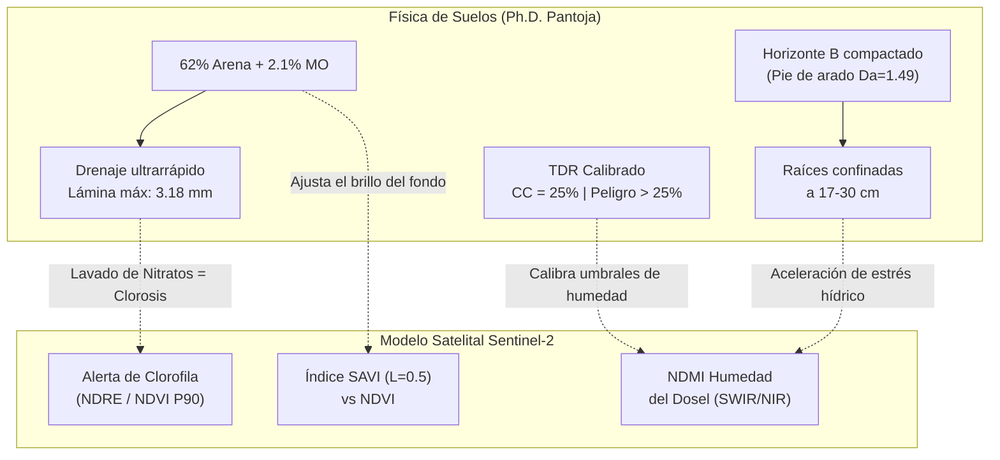

# 🛰️ PyGan AgroSat: Documentación Técnica y Metodología del Sistema de Monitoreo Satelital

**Proyecto:** Sistema de Monitoreo Satelital Agrícola Multi-Temporal (Sentinel-2 L2A) de Alta Precisión  
**Predio:** Finca PyGan (250 Bloques | 7,565 Camas Físicas | 36.52 Hectáreas | Campo Abierto)  
**Ubicación:** Ecuador (Lat: `0.142241`, Lon: `-78.393670` | Tile MGRS: `17NQA`)  
**Sistema de Referencia:** WGS 84 / UTM Zone 17S (`EPSG:32717`)  
**Entorno de Producción:** Servidor VPS Ubuntu (Hostinger) en Docker con Gunicorn y Nginx Reverse Proxy (SSL)  
**URL de Producción:** [https://satelital.velezrapp.cloud](https://satelital.velezrapp.cloud)  
**Repositorio Oficial:** [renealejo96/Florsani_NDVI](https://github.com/renealejo96/Florsani_NDVI)  

---

## 📌 1. Resumen Ejecutivo y Alcance

El sistema **PyGan AgroSat** es una plataforma integral de ingeniería de datos geoespaciales y analítica agronómica diseñada para transformar datos satelitales ópticos e infrarrojos de la constelación europea **Sentinel-2** en **decisiones agronómicas operativas a nivel de bloque y cama en campo abierto**.

A diferencia de los enfoques tradicionales (descarga manual de escenas de varios gigabytes):
1. **Arquitectura Cloud-Native:** Extrae exclusivamente las ventanas geográficas (*Windowed Reads*) de los 250 bloques del predio desde el almacenamiento cloud de Microsoft Planetary Computer mediante Cloud-Optimized GeoTIFFs (COGs).
2. **Corrección de Bordes y Ruido Perimetral:** Aplica un búfer negativo de `-5.0 metros` en cada polígono para eliminar zanjas, postes y caminos de servidumbre.
3. **Multiespectralidad y Series Temporales:** Calcula en la misma cuadrícula de 10 metros los índices de vigor vegetal (**NDVI**, **SAVI**) y contenido hídrico de dosel (**NDMI**), además de percentiles de alta resolución (**NDVI P90 - Máximo de Cama**).
4. **Cruce Agronómico Detallado (7,565 Camas):** Procesa el reporte agronómico semanal (`bq_sentinel.csv`), identificando siembras, podas, camas vacías (tumba), ensayos y variedades comerciales.
5. **Detección Dinámica de "Bloques Estrella":** Clasifica automáticamente los bloques 100% puros y homogéneos por cultivo comercial para servir de calibración y verdad de campo.
6. **Mapeo de Cambio Temporal ($\Delta$ Vigor / $\Delta$ Humedad):** Detecta caídas bruscas entre pasadas satelitales consecutivas para priorizar inspecciones de campo.

---

## 🌐 2. Catálogos Satelitales y Fuentes de Datos

### A. Catálogo STAC de Microsoft Planetary Computer
* **Endpoint Base:** `https://planetarycomputer.microsoft.com/api/stac/v1`
* **Colección utilizada:** `sentinel-2-l2a` (Nivel 2A: reflectancia calibrada de fondo de atmósfera o *Bottom-Of-Atmosphere* BOA).
* **Autenticación Cloud:** Librería `planetary_computer.sign_inplace` para firma dinámica de tokens SAS (*Shared Access Signatures*) sobre Azure Blob Storage.
* **Bandas Espectrales Procesadas:**
  * **B04 (Red, 665 nm, 10m):** Absorción de clorofila.
  * **B08 (NIR, 842 nm, 10m):** Reflectancia de la estructura celular del mesófilo foliar.
  * **B11 (SWIR-1, 1610 nm, 20m $\rightarrow$ Remuestreada a 10m vía VRT bilineal):** Absorción por contenido de agua en los tejidos vegetales.
  * **SCL (Scene Classification Layer, 20m $\rightarrow$ Remuestreada a 10m vía vecino más cercano):** Máscara de nubes, sombras de nubes y clasificación de píxeles.

### B. Capa Cartográfica Base
* **Google Satellite / Hybrid:** Mosaicos aéreos de ultra-alta resolución integrados mediante Leaflet.js para comparación visual contra los polígonos vectoriales.

### C. Archivo Agronómico Semanal de Camas (`bq_sentinel.csv`)
* **Registros:** ~8,856 filas detallando actividad (`Siembra`, `Poda`, `VACIO`), cultivo (`PRODUCTO MAESTRO`), variedad élite (`VARIEDADES ELITE`) y número de cama (`# Cama`).
* **Universo Físico:** 230 bloques analizados, 7,565 camas físicas únicas consolidadas.

---

## 🏗️ 3. Arquitectura del Sistema y Módulos de Software

```
┌─────────────────────────────────┐
│       satelital/pygan.shp       │ ──> Geometrías de 250 bloques (ArcGIS EPSG:32717)
└─────────────────────────────────┘
                 │
                 ▼
┌─────────────────────────────────┐
│     procesar_cultivos.py        │ ──> Agrupación cama a cama (7,565 camas),
│     (Cruce con bq_sentinel.csv) │     normalización de Hypericum y filtro de Bloques Estrella
└─────────────────────────────────┘
                 │
                 ▼
┌─────────────────────────────────┐
│     descargar_satelite.py       │ ──> Conexión STAC, extracción de bandas B04/B08/B11/SCL,
│     (ETL Incremental Satelital) │     cálculo zonal NDVI/SAVI/NDMI/P90 por bloque
└─────────────────────────────────┘
                 │
                 ▼
┌─────────────────────────────────┐
│      datos_procesados.json      │ ──> GeoJSON consolidado con 12 fechas históricas,
│     (Base de Datos del Modelo)  │     indicadores espectrales y metadata agronómica
└─────────────────────────────────┘
                 │
                 ▼
┌─────────────────────────────────────────────────────────────────┐
│                        app.py (Flask + Gunicorn)                │
│  - GET /                            : Dashboard Leaflet/Chart   │
│  - GET /api/datos                   : API GeoJSON Consolidada   │
│  - GET /api/satelite/pasadas-recientes : Radar STAC en Vivo     │
│  - GET /api/health                  : Healthcheck de Producción │
└─────────────────────────────────────────────────────────────────┘
```

### Componentes Principales:
1. [`procesar_cultivos.py`](file:////wsl.localhost/Debian/home/rvelez/proyectos/pygan%20%20ndvi/procesar_cultivos.py):
   * De-duplicación física por `# Cama` única para evitar inflar camas en lotes con ensayos o dobles registros.
   * Normalización inteligente de códigos alfanuméricos de *Hypericum* (ej. `17091`, `H21-68-7`, `18125-03`, `Magical...`) clasificándolos bajo el cultivo comercial correcto.
   * Aislamiento de categorías agronómicas: `CULTIVO HOMOGÉNEO`, `100% VACIO / TUMBA`, `SIEMBRA ESCALONADA (<=35% o ~5 camas)`, `COMERCIAL CON ENSAYO (1-6 camas)`, `MIXTO` y `ENSAYOS`.
2. [`descargar_satelite.py`](file:////wsl.localhost/Debian/home/rvelez/proyectos/pygan%20%20ndvi/descargar_satelite.py):
   * Motor incremental para descargar y calcular estadísticas zonales de una sola pasada satelital sin tener que reprocesar los meses previos.
   * Búsqueda automática de nuevas fechas despejadas ($<35\%$ nubes) desde la última registrada hasta hoy.
3. [`actualizar_semanal.py`](file:////wsl.localhost/Debian/home/rvelez/proyectos/pygan%20%20ndvi/actualizar_semanal.py):
   * Script automatizado de actualización agronómica semanal. Vincula los cambios del CSV con las geometrías GIS y, opcionalmente, busca o descarga la pasada satelital más reciente (`--satelite` o `--fecha YYYY-MM-DD`).
4. [`analisis_bloques_estrella.py`](file:////wsl.localhost/Debian/home/rvelez/proyectos/pygan%20%20ndvi/analisis_bloques_estrella.py):
   * Analiza la serie temporal multiespectral de los bloques puros candidatos para calibrar perfiles espectrales base por cultivo.

---

## 🧮 4. Fundamentación Matemática de los Índices Espectrales

$$\text{NDVI} = \frac{\text{NIR} - \text{RED}}{\text{NIR} + \text{RED}} = \frac{\text{B08} - \text{B04}}{\text{B08} + \text{B04}}$$

* **Rango:** $[-1.0, 1.0]$.
* **Propósito:** Mide biomasa fotosintéticamente activa.

$$\text{SAVI} = \frac{\text{NIR} - \text{RED}}{\text{NIR} + \text{RED} + L} \times (1 + L) \quad \text{con } L = 0.5$$

* **Propósito:** Ajuste de suelo para camas abiertas con suelo expuesto o cobertura vegetal intermedia, minimizando la influencia óptica del suelo.

$$\text{NDMI} = \frac{\text{NIR} - \text{SWIR}}{\text{NIR} + \text{SWIR}} = \frac{\text{B08} - \text{B11}}{\text{B08} + \text{B11}}$$

* **Propósito:** Detecta el contenido de agua en la cubierta vegetal y el estrés hídrico previo a que se manifiesten síntomas visuales de marchitamiento o necrosis.

$$\text{NDVI P90 (Máximo de Cama)} = \text{Percentil 90 del NDVI dentro del bloque}$$

* **Propósito:** En campo abierto con camas de $1\text{ m}$ y pasillos de tierra, el promedio general del bloque se diluye por el suelo expuesto. El **P90** captura exclusivamente el $10\%$ de píxeles con dosel vegetal más denso (la cresta de las camas activas), aislando el ruido de los pasillos sin requerir resolución de dron.

$$\Delta \text{ Cambio Temporal} = \text{Índice}(t_k) - \text{Índice}(t_{k-1})$$

* **Propósito:** Detecta caídas severas ($\Delta < -0.06$) ocasionadas por podas, tumbas o problemas sanitarios, y fuertes incrementos ($\Delta > +0.06$) correspondientes a brotes y floraciones.

---

## 🌸 5. Perfiles Espectrales Calibrados por Cultivo

A partir del análisis multitemporal de los **75 bloques puros (87 polígonos GIS)** sin ensayos ni divisiones, se establecieron los siguientes umbrales agronómicos en [`perfiles_calibrados.json`](file:////wsl.localhost/Debian/home/rvelez/proyectos/pygan%20%20ndvi/perfiles_calibrados.json):

| Cultivo Comercial | Bloques Estrella | NDVI Óptimo | Umbral Alerta NDVI | SAVI Típico | NDMI (Humedad) | CV % (Homogeneidad) |
| :--- | :---: | :---: | :---: | :---: | :---: | :---: |
| **SOLIDAGO** | 21 bloques (23 polígonos) | $0.38 - 0.46$ | $< 0.32$ | $0.32 - 0.37$ | $> 0.08$ | $5\% - 10\%$ (Muy uniforme) |
| **HYPERICUM** | 22 bloques (30 polígonos) | $0.42 - 0.58$ | $< 0.35$ | $0.35 - 0.40$ | $> 0.10$ | $6\% - 22\%$ (Dosel cerrado) |
| **VERONICA** | 16 bloques (16 polígonos) | $0.35 - 0.45$ | $< 0.29$ | $0.29 - 0.35$ | $> 0.06$ | $11\% - 20\%$ |
| **GYPSOPHILA** | 16 bloques (18 polígonos) | $0.27 - 0.33$ | $< 0.24$ | $0.22 - 0.26$ | $> 0.01$ | $3\% - 7\%$ (Follaje fino/blanco) |
| **SUELO / TUMBA** | 53 bloques en descanso | $0.12 - 0.26$ | -- | $0.18 - 0.21$ | $-0.05 \text{ a } 0.01$ | Suelo desnudo base |

---

## ☁️ 6. Historial Satelital y Resolución de la Paradoja de Nubes

El sistema evalúa la nubosidad mediante la banda **SCL** recortada exclusivamente sobre los polígonos de las **36.52 hectáreas** de la finca:

| Fecha Satelital | Satélite | Nubes Regionales (100x100 km) | Nubes Reales en Finca | Estado en Finca |
| :---: | :---: | :---: | :---: | :--- |
| **2026-06-19** | Sentinel-2C | 30.2% | **0.3%** | ☀️ Despejado |
| **2026-07-14** | Sentinel-2B | 45.9% | **0.0%** | ☀️ Cielo 100% Sol |
| **2026-07-29** | Sentinel-2C | 51.0% | **0.0%** | ☀️ Cielo 100% Sol |
| **2026-08-13** | Sentinel-2B | 35.7% | **0.0%** | ☀️ Cielo 100% Sol |
| **2026-09-12** | Sentinel-2B | 53.4% | **0.0%** | ☀️ Cielo 100% Sol |
| **2026-09-17** | Sentinel-2C | 69.1% | **16.4%** | ⛅ Claro Parcial |
| **2026-09-27** | Sentinel-2C | 83.6% | **0.0%** | ☀️ Cielo 100% Sol |
| **2026-09-29** | Sentinel-2A | 88.1% | **0.0%** | ☀️ Cielo 100% Sol |
| **2026-10-09** | Sentinel-2A | 65.6% | **14.9%** | ⛅ Claro Parcial |
| **2026-10-19** | Sentinel-2B | 54.8% | **0.0%** | ☀️ Cielo 100% Sol |
| **2026-10-22** | Sentinel-2B | 30.2% | **0.0%** | ☀️ Cielo 100% Sol |
| **2026-10-27** | Sentinel-2C | 10.1% | **0.0%** | ☀️ Cristalino (100% Sol) |

> **Conclusión Científica:** Un filtro regional tradicional habría descartado tomas espectaculares como el 27 y 29 de septiembre (con $>80\%$ regional). El análisis de píxeles SCL locales demostró que la finca tenía **0.0% de nubes**, recuperando observaciones cruciales de crecimiento.

---

## 🖥️ 7. Funcionalidades del Dashboard Frontend

1. **Mapa Interactivo Leaflet:**
   * **Modo Pantalla Completa:** Botón flotante para auditoría en reuniones o salas de control.
   * **Etiquetas Permanentes de Bloques:** Switch para encender/apagar nombres de bloques directamente sobre el mapa sin necesidad de hacer hover.
   * **Renderizado Inteligente de Tumbas:** Los bloques vacíos o en preparación se muestran transparentes con borde punteado tenue, evitando que el mapa se tiña de rojo falsamente.
   * **Mapa de Cambio ($\Delta$):** Rampa divergente de 5 colores (Verde: Crecimiento $\rightarrow$ Gris: Estable $\rightarrow$ Rojo: Caída) con tarjetas KPI dinámicas de lotes en aumento y pérdida.
2. **Tabla de Priorización Agronómica:**
   * Ordenamiento jerárquico automático de 3 niveles:
     1. Bloques en Alerta de Vigor / Estrés hídrico primero.
     2. Agrupación por Flor / Cultivo.
     3. Orden natural del número de bloque (ej. 1, 2, 10 en vez de 1, 10, 2).
3. **Modal de Bloques en Alerta con Redirección:**
   * Lista detallada de lotes comprometidos con botón **"Ver en Mapa"** que cierra el modal, centra el bloque con zoom automático y hace scroll suave directo al visor.
4. **Radar Satelital en Vivo:**
   * Consulta directa al catálogo STAC mostrando las próximas pasadas de Sentinel-2 para planificar la siguiente actualización.

---

## 🚀 8. Arquitectura de Despliegue en Producción

* **Entorno:** Servidor VPS Hostinger (Ubuntu 24.04 LTS).
* **Contenedorización:** Docker & Docker Compose con reinicio `unless-stopped`.
* **Servidor de Aplicaciones:** Gunicorn WSGI con 3 workers concurrentes (`--timeout 120`).
* **Puerto de Servicio:** `5055` (personalizado para evitar colisiones con puertos 80, 443, 3000, 5000, 8080).
* **Reverse Proxy:** Nginx gestionando el tráfico público en los puertos 80 y 443.
* **Seguridad SSL:** Certificados automáticos Let's Encrypt mediante Certbot con redirección HTTPS forzada en `https://satelital.velezrapp.cloud`.
* **Persistencia de Datos:** Volúmenes montados para `datos_procesados.json`, `bq_sentinel.csv`, `cultivos_por_bloque.json` y `satelital/`, permitiendo actualizaciones inmediatas con `git pull` sin necesidad de reconstruir la imagen de Docker.

---

## 🤖 9. Inteligencia Artificial Operativa: Clasificación Píxel a Píxel con Random Forest

### A. El Problema Agronómico Resuelto: La Trampa Óptica del Suelo Interlínea
En la floricultura a campo abierto, las camas tienen típicamente $1.0\text{ m}$ de ancho y están separadas por pasillos de tierra de $0.5\text{ a }0.8\text{ m}$. Debido a que el satélite Sentinel-2 captura píxeles de $10\times 10\text{ m}$ ($100\text{ m}^2$ por píxel):
* **El engaño del promedio simple:** Un píxel espacial suele contener $6\text{ a }8$ camas junto con sus respectivos pasillos de suelo desnudo. Aunque las plantas de *Hypericum*, *Gypsophila*, *Veronica* o *Solidago* estén $100\%$ sanas, el suelo seco interlínea atenúa la reflectancia, arrojando valores de NDVI artificialmente bajos ($0.30 - 0.35$).
* **El riesgo agronómico:** Un sistema ciego alertaría falsamente que el cultivo está enfermo, muriendo o bajo estrés crítico cuando en realidad las plantas tienen un dosel foliar perfecto.

---

### B. Metodología de Entrenamiento y Verdad de Campo (*Ground Truth*)
Para resolver esto con Machine Learning supervisado en [`entrenar_random_forest.py`](file:////wsl.localhost/Debian/home/rvelez/proyectos/pygan%20%20ndvi/entrenar_random_forest.py):
1. **Universo de Entrenamiento Puro:**
   * **87 Polígonos de Bloques Estrella:** Muestreados en sus zonas de dosel activo ($\ge 0.30$ NDVI) como etiquetas puras de `CULTIVO_ACTIVO` (Clase 1).
   * **53 Polígonos en Tumba / Descanso:** Muestreados sobre suelo expuesto ($\le 0.28$ NDVI) como etiquetas puras de `SUELO_DESNUDO` (Clase 0).
2. **Muestreo Multitemporal:** Se extrajeron **1,811 firmas espectrales independientes** a lo largo de 3 pasadas satelitales despejadas con $0.0\%$ de nubes locales (27 de octubre, 22 de octubre y 13 de agosto de 2026), capturando variaciones de humedad, hora solar y estados vegetativos.
3. **Vector de Entrada (8 Atributos Físico-Ópticos):**
   * Bandas espectrales brutas: $B04$ (Rojo), $B08$ (NIR), $B11$ (SWIR-1).
   * Índices biofísicos: $NDVI$, $SAVI$ ($L=0.5$), $NDMI$.
   * Ratios de dispersión celular: $\text{Ratio NIR/Rojo}$ y $\text{Ratio NIR/SWIR}$.

---

### C. Métricas de Rendimiento y Validación Estadística

#### Modelo 1: Detector Binario de Dosel (`modelos/modelo_rf_cobertura.joblib`)
* **Exactitud Global (*Accuracy*):** **`99.56%`**
* **F1-Score Ponderado:** **`99.58%`**
* **Matriz de Confusión en Conjunto de Prueba Ciego (453 píxeles):**

| Clase Real \ Predicción | Predicho como SUELO | Predicho como CULTIVO | Precisión | Recall |
| :--- | :---: | :---: | :---: | :---: |
| **SUELO DESNUDO (0)** | **215** | 0 | **100.0%** | **100.0%** |
| **CULTIVO ACTIVO (1)** | 2 | **236** | **100.0%** | **99.2%** |

* **Jerarquía de Importancia de Variables (Gini Feature Importance):**
  1. **NDVI:** $28.31\%$ (Absorción neta de clorofila vs reflectancia del suelo).
  2. **Ratio NIR/Red:** $26.09\%$ (Estructura celular esponjosa del mesófilo).
  3. **NDMI (Humedad foliar):** $12.85\%$ (Contenido hídrico celular en $B11$).
  4. **SAVI:** $11.46\%$ (Corrección del brillo de fondo).
  5. **Ratio NIR/SWIR:** $11.07\%$ (Firma de absorción de agua).
  6. **B08 (NIR):** $5.78\%$ | **B04 (Red):** $3.25\%$ | **B11 (SWIR):** $1.19\%$.

> **Conclusión Biofísica:** El algoritmo aprendió que el agua celular y el contraste entre el infrarrojo cercano y el infrarrojo de onda corta ($B11$) son la firma inequívoca que separa el tejido vegetal hidratado del suelo inerte, logrando un desacople casi perfecto ($99.56\%$).

#### Modelo 2: Clasificador Multiespecie (`modelos/modelo_rf_multiclase.joblib`)
* **Exactitud Global:** **`79.25%`** separando entre *Gypsophila*, *Hypericum*, *Solidago*, *Veronica* y *Suelo Desnudo*.
* El suelo desnudo mantiene **$100\%$ de precisión y recall**, mientras que las flores presentan firmas espectrales diferenciadas por su estructura de hoja (*Hypericum* de hoja ancha cerosa vs *Gypsophila* de follaje fino y velo floral).

---

### D. Aplicación Operativa: Cruce del Reporte CSV vs Inferencia IA

Con el módulo [`evaluar_cobertura_rf.py`](file:////wsl.localhost/Debian/home/rvelez/proyectos/pygan%20%20ndvi/evaluar_cobertura_rf.py), el sistema evalúa los 250 bloques y produce el reporte cruzado:

| Bloque | Flor / Cultivo | Camas Reportadas | % Camas Activas (CSV) | % Cobertura Foliar Real (IA) | % Suelo Expuesto (IA) | Diagnóstico Agronómico Cruzado |
| :---: | :---: | :---: | :---: | :---: | :---: | :--- |
| **31** | VACIO / TUMBA | $0 / 15$ | $0.0\%$ | **$0.0\%$** | **$100.0\%$** | 🟫 **Suelo Confirmado:** El modelo valida que el lote está $100\%$ libre en descanso. |
| **13D** | HYPERICUM | $27 / 27$ | $100.0\%$ | **$40.0\%$** | **$60.0\%$** | 🌿 **Rebrote / Cobertura Media:** Las camas están activas, pero el dosel aún no cierra pasillos. No hay estrés patológico. |
| **22** | HYPERICUM | $3 / 26$ | $11.5\%$ | **$71.4\%$** (en camas) | **$28.6\%$** | 🌱 **Siembra Escalonada Validada:** Las 3 camas nacientes tienen excelente vigor foliar local sobre el lote abierto. |
| **101** | GYPSOPHILA | $17 / 17$ | $100.0\%$ | **$25.0\%$** | **$75.0\%$** | 🌸 **Dosel Abierto Típico:** Típico en velo de novia podado o en apertura; la planta no está enferma, solo tiene arquitectura fina. |

---

### E. Integración en el Dashboard Web
En la interfaz visual de [https://satelital.velezrapp.cloud](https://satelital.velezrapp.cloud):
1. **Popups de Cada Bloque:** Al hacer clic sobre cualquier polígono, el sistema muestra:  
   `Cobertura Foliar (IA): XX% Dosel (YY% suelo)`  
   Permitiendo al agrónomo confirmar al instante si un valor moderado de NDVI es por daño en la planta o simplemente por pasillos de suelo desnudo.
2. **Auditoría de Emergencia:** Permite cruzar en campo si bloques que supuestamente tienen 100% de camas sembradas presentan fallas de germinación o huecos físicos detectados por el porcentaje de suelo expuesto.

---

## 🔬 10. Física de Suelos, Dinámica Hídrica y Calibración TDR (Estudio de Octubre 2026)

En octubre de 2026, el especialista en manejo de suelos y nutrición vegetal **José L. Pantoja, Ph.D.** (ANALYTIC S.A.S. / AGNLatam S.A.) realizó una evaluación física, hidráulica y nutricional in situ en Finca Pygan (*"Informe de evaluación de suelos de la Finca Pygan, de la empresa FLORSANI"*). Este estudio aportó los parámetros edáficos fundamentales para calibrar y enriquecer el sistema satelital.

### A. Caracterización Textural y Estructural
* **Composición Granulométrica Promedio (Textura Liviana):**
  * **Arena:** **`62%`** (predominio de arena fina de alta permeabilidad).
  * **Limo:** **`29%`** (fracción intermedia).
  * **Arcilla:** **`9%`** (muy baja fracción coloidal).
  * **Clasificación Textural:** Suelos Franco-Arenosos a Arenosos-Limosos.
* **Materia Orgánica (MO):** Promedio de **`2.1%`** en el horizonte superficial A (considerablemente bajo, favorece el drenaje rápido y limita la retención de cationes).
* **Densidad Aparente ($Da$):** Promedio de **`1.22 g/mL`** en horizonte A, aumentando hasta **`1.49 g/mL`** en el horizonte B compactado.
* **Porosidad Total:** Promedio de **`47.0% a 49.8%`** de espacio poroso.
* **Problemática Crítica Subterránea (Pie de Arado):** En la mayoría de los perfiles no subsolados, el horizonte B (a partir de los 20–30 cm) presenta una **compactación severa con estructura masiva**, generada por la mecanización histórica con arados de disco.

---

### B. Constantes Hidráulicas y Lámina Máxima de Riego

Aplicando el modelo de **Silva et al. (1988)** para suelos con corrección por materia orgánica sobre el horizonte A (profundidad media de 17.0 cm, $Da = 1.22\text{ g/mL}$):

$$CC = 8.658 + 2.571(\% \text{MO}) + 0.296(\% \text{Limo}) = 16.71\% \text{ gravimétrico} \rightarrow \mathbf{56.81\text{ mm}}$$
$$PMP = 0.74(CC) - 5 = 7.37\% \text{ gravimétrico} \rightarrow \mathbf{25.06\text{ mm}}$$
$$AD = CC - PMP = \mathbf{31.75\text{ mm}}$$

* **Agua Fácilmente Disponible (AFD = 50% de AD):** **`15.87 mm`**.
* **Lámina Máxima de Reposición por Pulso de Riego (10% de AD):** **`3.18 mm por pulso`**.

> [!IMPORTANT]
> **Regla Operativa de Riego:** Debido a que el suelo contiene 62% de arena y macro-poros de drenaje acelerado, **ningún pulso de riego debe superar los 3.18 mm**. Cualquier lámina mayor percola por gravedad hacia el horizonte profundo lavando el nitrógeno y potasio (lixiviación nutricional) o asfixiando temporalmente la raíz si se acumula sobre el pie de arado.

---

### C. Ecuaciones Logarítmicas de Calibración del Sensor TDR 150

El informe del Dr. Pantoja demostró que la relación entre la lectura en campo del sensor de reflectometría de dominio de tiempo (**FieldScout TDR 150**, calibrado para arena) y la humedad volumétrica real determinada en laboratorio sigue modelos logarítmicos de alta precisión:

* **Ecuación General (Finca Pygan):**
  $$y = 15.967 \ln(x) - 22.375 \quad (R^2 = 0.7074)$$
* **Ecuación Antes del Riego:**
  $$y = 14.247 \ln(x) - 17.898 \quad (R^2 = 0.7724)$$
* **Ecuación Después del Riego:**
  $$y = 17.759 \ln(x) - 27.399 \quad (R^2 = 0.6330)$$
  *(Donde $x$ = Lectura directa del TDR 150 en %, $y$ = Humedad volumétrica en laboratorio en %)*

#### Factor de Corrección por Materia Orgánica:
Por cada $1.0\%$ de MO analizada en el suelo, se deben sumar **$+2$ unidades** a la lectura del TDR 150. Con el promedio de $2.1\%$ de MO de Pygan, la corrección fija es de **$+4.2$ unidades**.

**Umbrales Operativos de Humedad con TDR 150:**
* **Capacidad de Campo Óptima ($CC$):** **`25.0%`**
* **Umbral de Inicio de Riego (Antes de Regar):** **`26.0%`** (lectura de campo $\approx 21-22\%$)
* **Límite Máximo Post-Riego:** **`24.5% a 25.0%`**
* **Alerta Sanitaria Vespertina:** Humedades $> 25.0\%$ al final de la tarde provocan **gutación nocturna**, disparando el riesgo de infección por *Botrytis cinerea*.

---

### D. Red de Muestreo de Calicatas (14 Puntos Georreferenciados)

El sistema incorpora los datos edáficos de las 14 calicatas muestreadas en la finca:

| Calicata | Bloque | Condición | Horizonte A | Textura | Horizonte B / Compactación | TDR Antes / Después |
| :---: | :---: | :---: | :---: | :---: | :---: | :---: |
| **1** | **154** | Sembrado | 30 cm | Limo-Arenoso (LA) | Masiva compactada a 70 cm | 27.7% / 27.4% |
| **2** | **103** | Subsolado previo | 30 cm | Limoso (L) | Excelente respuesta al subsolado | 9.9% / 26.7% |
| **3** | **13B** | Verónica | 30 cm | Limo-Arenoso (LA) | Arcillo-Limoso masivo a 80 cm | 11.5% / 18.3% |
| **4** | **74** | En descanso | 40 cm | Limo-Arenoso (LA) | Masiva a 90 cm; Limoso a 110+ cm | 15.6% / 10.8% |
| **5** | **92** | En descanso | 50 cm | Limoso (L) | Perfil profundo de alta retención | 22.6% / 22.8% |
| **6** | **84** | Con Cascajo | 50 cm | Limoso (L) | Presencia de cascajo y arena gruesa | 22.2% / 24.9% |
| **7** | **31E** | En descanso | **20 cm** | **Arena-Limosa (AL)** | **Capa muy delgada; arena pura a 90 cm** | 12.5% / 14.5% |
| **8** | **38** | Subsolado/Sembrado | 30 cm | Limoso (L) | Estructura migajosa óptima (Da=1.00) | 8.9% / 12.1% |
| **9** | **41H** | Subsolado/Sembrado | 30 cm | Limoso (L) | Subsuelo arcilloso a 100+ cm | 16.9% / 24.7% |
| **10** | **51C** | Sin sembrar | 30 cm | Limo-Arcilloso (LAr) | Mayor proporción de finos | 21.2% / 22.7% |
| **11** | **135** | Sin sembrar | 40 cm | Limo-Arcilloso (LAr) | Horizonte C de arena suelta a 60 cm | 32.9% / 30.3% |
| **12** | **224** | Sin sembrar | 30 cm | Limoso (L) | Da elevada (1.47 g/mL); subsoleo urgente | 28.2% / 29.0% |
| **13** | **217** | Sin sembrar | 30 cm | Limo-Arenoso (LA) | Horizonte B compactado masivo | 14.9% / 25.4% |
| **14** | **26** | Sin sembrar | 40 cm | Limoso (L) | Capa arable profunda (40 cm) | 26.2% / 28.2% |

---

## 🧠 11. Dimensiones Avanzadas de Agronomía de Precisión (Suelo + Satélite + IA)

Integrando la física de suelos con la constelación Sentinel-2 y los modelos Random Forest, el sistema ejecuta 6 dimensiones analíticas:



### Dimensión 1: Modelado de Evapotranspiración ($ET_c$) y Frecuencia de Riego
* **$K_c$ Dinámico Espacial:** Calcula el coeficiente de cultivo por bloque en función del SAVI:
  $$K_c = 1.2 \times \left(\frac{\text{SAVI} - \text{SAVI}_{\text{suelo}}}{\text{SAVI}_{\text{máx}} - \text{SAVI}_{\text{suelo}}}\right)$$
* **Fraccionamiento Automático:** Si el consumo diario excede la lámina de reposición ($ET_c > 3.18\text{ mm}$), la plataforma alerta la necesidad de **dividir el fertirriego en 2 pulsos** (mañana 07:30 y mediodía 11:30), prohibiendo riegos largos vespertinos.

### Dimensión 2: Sensor Virtual de Humedad Subterránea (TDR Virtual)
* **Inferencia Espacial:** A partir del NDMI (bandas $B08$ y $B11$) calibrado con la ecuación logarítmica del Dr. Pantoja, se infiere el % de humedad volumétrica TDR para los 250 bloques del predio.
* **Semáforo Operativo:**
  * **$< 18\%$ (Déficit Hídrico):** Las plantas gastan energía para absorber agua (disminución de longitud de tallos florales).
  * **$18\% - 25\%$ (Óptimo a Capacidad de Campo):** Turgencia máxima celular.
  * **$> 25\%$ (Saturación y Peligro Sanitario):** Anoxia radicular y riesgo de gutación.

### Dimensión 3: Índice de Riesgo de Lixiviación (IRL) de Nitratos
* Conociendo la textura de 62% arena, la baja MO (2.1%) y la CIC deficiente, los bloques con **bajo dosel foliar (<35%)** o en etapa post-poda/tumba carecen de raíces que absorban la solución nutritiva.
* Si el operario riega tiempos de rutina en bloques con bajo dosel, **el 60% del fertilizante nitrogenado ($NO_3$) se lixivia**. La plataforma emite una alerta roja:  
  `Riesgo de Lixiviación ALTO: Reducir lámina a < 2.0 mm y fraccionar pulso.`

### Dimensión 4: Alerta Fitosanitaria de Gutación Nocturna (Riesgo *Botrytis* / Mildiú)
* Cuando un bloque combina **alta densidad de biomasa ($P_{90} > 0.52$ o dosel cerrado $>65\%$)** con **humedad satelital saturada ($NDMI > 0.17$)**, la presión radicular fuerza la exudación de savia por los bordes de hojas y cálices durante la noche (gutación).
* Estas gotas ricas en azúcares germinan esporas de *Botrytis cinerea*. El sistema emite la recomendación preventiva:  
  `Alerta de Gutación: Cortar el riego antes de las 14:00 y favorecer la ventilación lateral de cortinas.`

### Dimensión 5: Detección de "Pie de Arado" y Recomendación de Subsoleo en Bloques Vacíos
* **Diagnóstico en Lotes en Descanso (Tumba / Vacío):** Los bloques vacíos son la única ventana donde se puede intervenir mecánicamente el perfil. El sistema alerta automáticamente:  
  `🚜 Pie de Arado: Bloque en descanso. Subsoleo con cincel a 40-50 cm obligatorio antes del armado de camas y siembra.`
* **Diagnóstico en Lotes Activos:** Bloques con capa arable delgada (como el Bloque 31E con apenas 20 cm) muestran caídas bruscas de vigor al mediodía porque su reserva de agua útil ($AFD$) es inferior a 12 mm.

### Dimensión 6: Detección Temprana de Clorosis por Desbalance Químico ($PO_4$ vs Fe/Zn)
* El análisis químico evidenció niveles excesivos de Fósforo ($PO_4$) que antagonizan con el Zinc y Hierro. Utilizando el índice **NDRE** (bandas $B05$ a 705 nm y $B08A$ a 865 nm), la plataforma detecta clorosis nutricionales **7 a 10 días antes de que sean visibles para el ojo humano**.

---

## 📚 12. Manual Técnico y Glosario Completo de Siglas

### A. Siglas de Teledetección y Sensores Satelitales

| Sigla | Nombre Completo | Definición Técnica | Rango Típico y Umbral Florícola |
| :--- | :--- | :--- | :--- |
| **NDVI** | *Normalized Difference Vegetation Index* | Índice normalizado de vegetación basado en la absorción de luz roja ($B04$) por la clorofila y la reflexión del infrarrojo cercano ($B08$). | **-1.0 a 1.0**. En floricultura: $>0.45$ (vigor alto), $0.35-0.45$ (moderado), $<0.35$ (alerta crítica). |
| **SAVI** | *Soil Adjusted Vegetation Index* | Índice ajustado a la influencia del suelo mediante el factor $L=0.5$. Esencial en suelos arenosos de Pygan para evitar la distorsión del brillo del fondo. | Similar al NDVI, pero mucho más estable en bloques podados o flor joven (<40% cobertura). |
| **NDMI** | *Normalized Difference Moisture Index* | Índice de humedad normalizada basado en $B08$ (NIR) y $B11$ (SWIR a 1610 nm). Mide el agua líquida contenida en los tejidos foliares y el suelo. | $>0.15$ (muy hidratado), $0.08-0.15$ (óptimo), $<0.05$ (déficit hídrico o estrés celular). |
| **NDRE** | *Normalized Difference Red Edge* | Índice del borde rojo que utiliza la banda estrecha $B05$ (705 nm). Sensible a pequeñas variaciones de clorofila y desbalances nutricionales tempranos. | Utilizado para detectar clorosis férrica o toxicidad por fosfatos antes de síntomas visuales. |
| **P90** | Percentil 90 de NDVI | Representa el vigor del 10% superior de píxeles del bloque. Mide el vigor pico de las mejores camas, descartando pasillos de tierra. | Si $P90$ es alto pero la mediana es baja, hay heterogeneidad en el riego de las camas. |
| **P10** | Percentil 10 de NDVI | Representa el vigor del 10% inferior del bloque (las camas más débiles o afectadas). | Marcador temprano de focos de marchitez o taponamiento de goteros. |
| **CV** | Coeficiente de Variación (%) | Desviación estándar dividida entre la media, multiplicada por 100. Evalúa la uniformidad intra-bloque. | **$<15\%$:** Excelente uniformidad. **$>25\%$:** Alta variabilidad (camas desparejas, problemas de goteros). |
| **RF Cobertura** | Cobertura Foliar Random Forest | Porcentaje de píxeles del bloque clasificados por IA como dosel vegetal vivo versus suelo inerte desnudo. | $0\%$ (suelo puro / post-poda) a $100\%$ (dosel completamente cerrado). |

### B. Siglas de Suelo, Riego e Hidráulica Agronómica

| Sigla | Nombre Completo | Definición Técnica | Valor en Finca Pygan |
| :--- | :--- | :--- | :--- |
| **TDR** | *Time-Domain Reflectometry* | Reflectometría en el dominio del tiempo. Mide la constante dieléctrica del suelo para estimar el porcentaje volumétrico de agua ($\theta_v$). | Sensor FieldScout TDR 150. Capacidad de campo calibrada: **`25.0%`**. |
| **CC** | Capacidad de Campo | Contenido de agua que un suelo puede retener contra la fuerza de gravedad tras el drenaje del agua libre. | **`16.71% gravimétrico`** = **`56.81 mm`** en los primeros 17 cm. |
| **PMP** | Punto de Marchitez Permanente | Humedad mínima del suelo a la cual la raíz de la flor ya no puede succionar agua (tensión de -15 bar). | **`7.37% gravimétrico`** = **`25.06 mm`**. |
| **AD** | Agua Disponible ($CC - PMP$) | Lámina total de agua almacenable en el horizonte superficial que las raíces pueden absorber. | **`31.75 mm`** en el horizonte A. |
| **AFD** | Agua Fácilmente Disponible | 50% del Agua Disponible. El agua que la planta extrae sin experimentar ningún freno fotosintético ni estrés celular. | **`15.87 mm`**. |
| **Lámina Máx** | Lámina Máxima de Reposición | 10% del Agua Disponible. Lámina máxima segura aplicable en un solo pulso de fertirriego sin causar lavado ni lixiviación. | **`3.18 mm por pulso`**. |
| **IRL** | Índice de Riesgo de Lixiviación | Métrica que estima la vulnerabilidad de pérdida de nitratos y fertilizantes por drenaje rápido en suelo arenoso según la cobertura foliar. | **Alto** en coberturas $<35\%$; **Bajo** en dosel cerrado $>65\%$. |
| **Gutación** | Exudación de savia nocturna | Gotas de agua y azúcares expulsadas por hidátodos en las hojas cuando el suelo queda saturado al atardecer ($TDR > 25\%$). | Principal factor predisponente para epidemias de *Botrytis cinerea*. |
| **Pie de Arado** | Capa compactada masiva | Estrato endurecido en el horizonte B (20 a 70 cm, $Da = 1.49$) que restringe el crecimiento radicular y retiene sales. | Requiere **subsoleo profundo (40-50 cm)** en bloques vacíos antes de la siembra. |

---

*Documentación técnica actualizada y validada para PyGan AgroSat (Finca PyGan / Florsani NDVI).*

